# Wingmate

A free companion app for **Aion 2** by BeeSpecial3D.

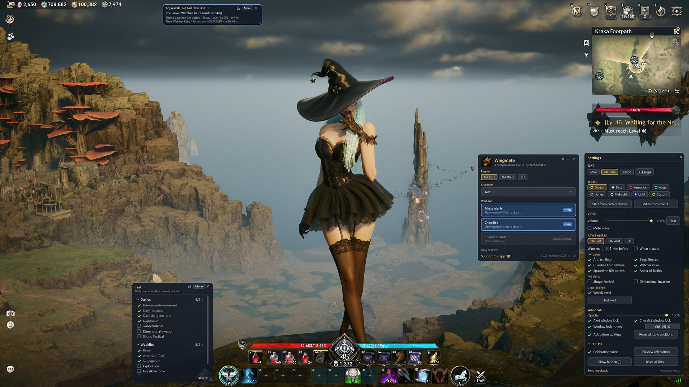

### Abyss and event alerts
A small countdown overlay for the Abyss and server events (Artifact Siege, Nahma, Rift portals, Arena and more), with spoken warnings from Bella before each one starts. NA and EU times.

**Custom alerts:** add your own in **Settings > Alerts > Add custom alert…**: give it a name, a time, the days it runs and, if you like, a repeat every few hours. Custom alerts count down and speak like the built-in events. You can turn one off, edit it or delete it at any time.

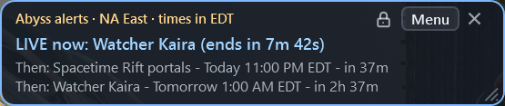

### Checklists for each character
Daily and weekly lists that reset on their own, an Events list, plus your own custom lists.

**Events list:** Shugo Festival, Dimensional Invasion, Artifact Siege, Arena of Tactics and limited-time events such as the Spiritstone shop event. Wingmate keeps this list up to date for you: each item resets on its own schedule (daily or weekly), and limited-time events hide by themselves when they end. You can check and uncheck items, but you can't edit this list. If you renamed one of these items in your own Dailies or Weeklies before, your copy stays where it is.

**New weeklies:** Command Missions (12), Abyss Command Missions (20), Battlefield (3 wins) and Subscriber Shop. They're added once to existing Weeklies lists. Items you already have aren't added twice, and anything you delete later doesn't come back.

Checked items disappear one at a time as you check them, and checking the last one sets off the list celebration. Right after you check an item, **Checked … · Undo** shows for a few seconds: click **Undo** if you misclicked. Checked items aren't lost: the resets (and **Reset all lists**) bring them back unchecked. Turn on **Show checked items** in the checklist's right-click menu to see checked items again (green check, struck through) and click one to uncheck it.

**Check all and hide:** right-click a list and pick **Check all and hide** to check off the whole list at once. The list celebrates, then hides until its items reset. **Checked all in … · Undo** puts every item back the way it was. This is different from **Hide list (no checking)**, which only hides the list.

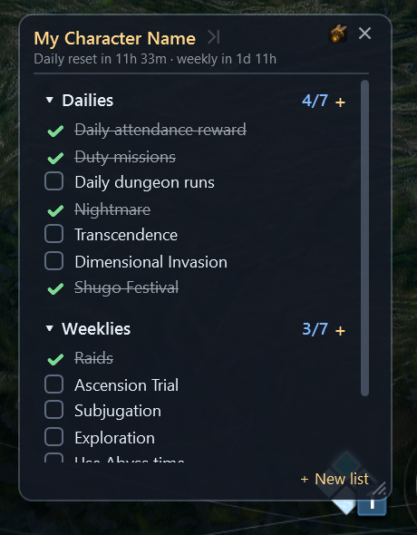

### Launcher
Pick your region and character, and open or close the alerts and checklist windows. The **Menu** button on the alerts and checklist windows opens or closes the launcher; Settings and Custom colors close with it and come back when it reopens. Drag the launcher's edges or its corner grip to resize it. Wingmate remembers where you put the launcher and Settings (and the launcher's size), and if you close Wingmate with the launcher's **×**, the windows you had open come back where you left them next time.

**First run:** the launcher asks for your character name first. Type it and press **Save** (or Enter); the Checklist unlocks once a name is saved. You can also pick your class there (optional). The alerts work right away.

**Welcome guide:** the first time Wingmate opens (and once after updating to 1.0.7) a short guide walks you through the basics. Open it again any time with **Show welcome guide** in Settings, on the About tab.

**Class:** each character can have a class (Gladiator, Templar, Assassin, Ranger, Sorcerer, Spiritmaster, Cleric or Chanter). Set or change it with the **Class** button next to the character name, on the first-run screen, or from the **Class** entry in the right-click menus. Pick **No class** there to clear it. Changing class never touches your lists.

**Guide:** the launcher's **Guide** button opens your class's guide in your browser. Class guides by AION 2 Global Guides ([aion2-guides.info](https://aion2-guides.info)). If you haven't picked a class yet, Guide asks for it first.

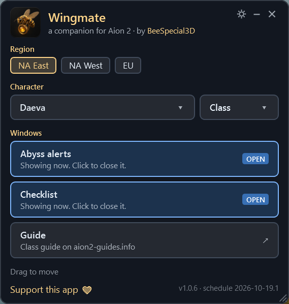

### Lock windows
Click the **padlock** on the alerts or checklist window to lock it: clicks then pass straight through to the game. The padlock itself stays clickable, so click it again to unlock. While the checklist is locked, only scrolling (mouse wheel) and its checkboxes work. Clicks anywhere else on the list itself do nothing and don't reach the game. Its header, buttons and edges still pass clicks through to the game. You can also use **Alert window lock** and **Checklist window lock** in Settings or the tray menu, or the optional window lock hotkey (Ctrl+Alt+K by default).

### Settings
Text size, theme, voice volume, which alerts to hear, custom alerts, opacity and window locks, sorted into tabs: **General**, **Appearance**, **Alerts**, **Checklist** and **About**. Text size applies right away to every window, including Settings, Custom colors, the color picker and the update pop-up. The Settings window itself always stays fully opaque so it's easy to read.

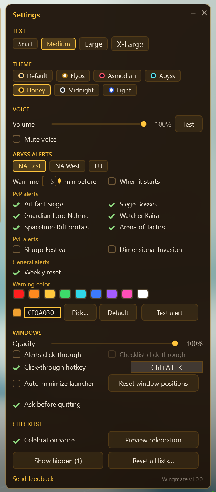

### Themes
Default, Elyos, Asmodian, Abyss, Honey, Midnight and Light, each with its own opacity and warning color. Or pick **Custom** and choose every color yourself (background, text, borders, accents, checkmarks, the warning color and more).

<table>
  <tr>
    <td>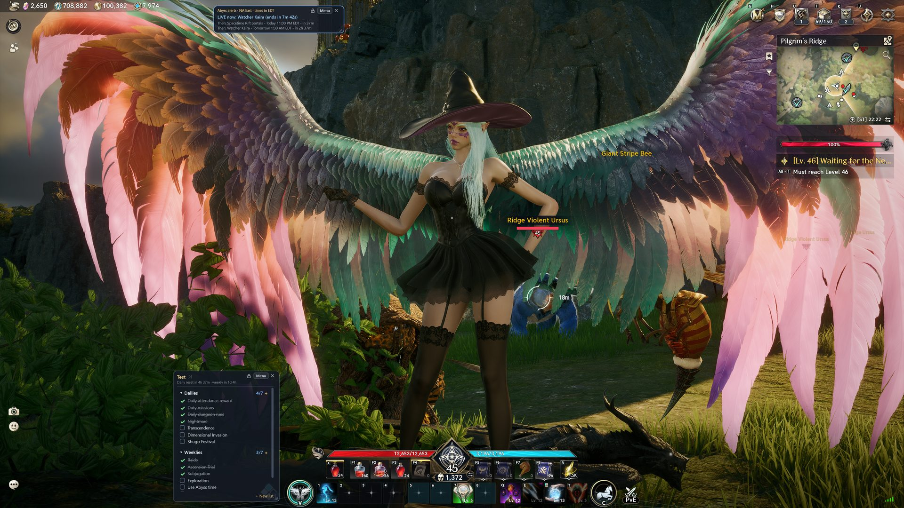</td>
    <td>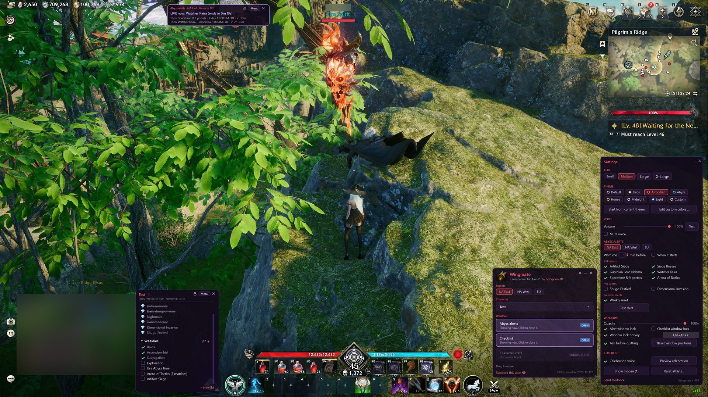</td>
    <td>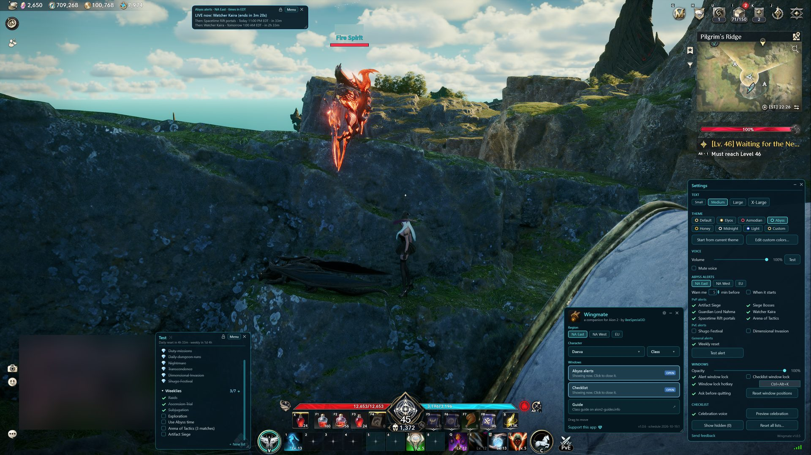</td>
  </tr>
  <tr>
    <td align="center">Default</td>
    <td align="center">Asmodian</td>
    <td align="center">Abyss</td>
  </tr>
  <tr>
    <td>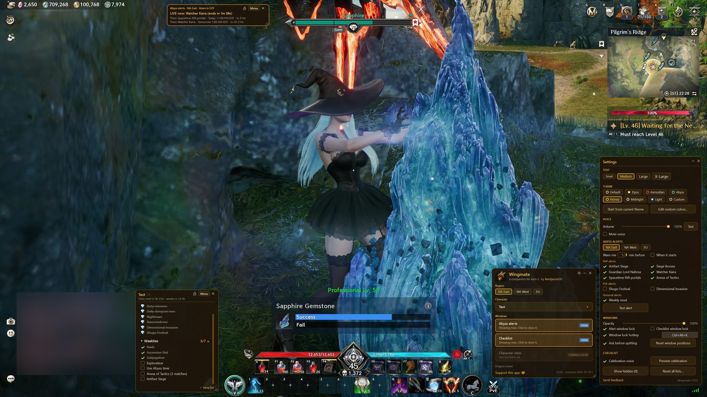</td>
    <td>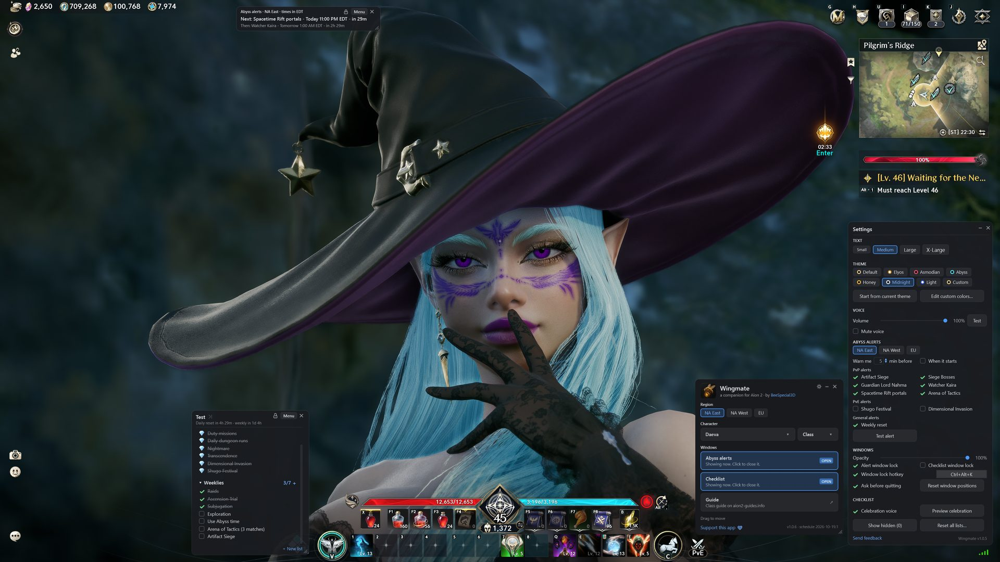</td>
    <td></td>
  </tr>
  <tr>
    <td align="center">Honey</td>
    <td align="center">Midnight</td>
    <td></td>
  </tr>
</table>

<table>
  <tr>
    <td></td>
    <td>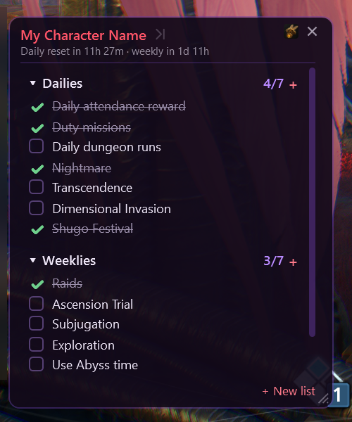</td>
    <td>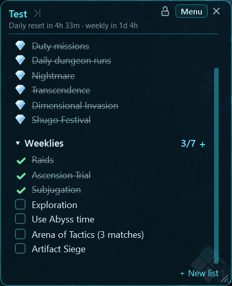</td>
    <td>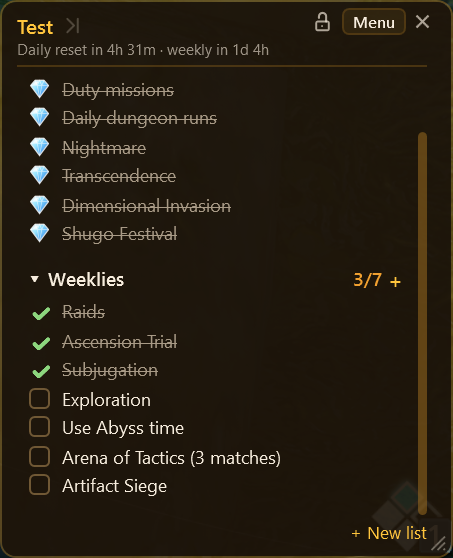</td>
    <td>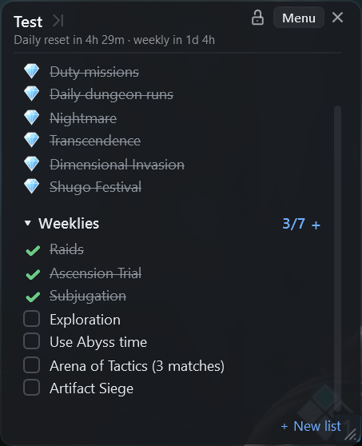</td>
  </tr>
  <tr>
    <td align="center">Default</td>
    <td align="center">Asmodian</td>
    <td align="center">Abyss</td>
    <td align="center">Honey</td>
    <td align="center">Midnight</td>
  </tr>
</table>

<table>
  <tr>
    <td></td>
    <td>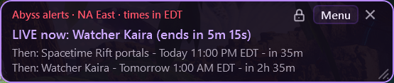</td>
    <td>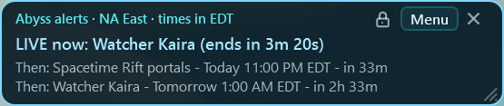</td>
  </tr>
  <tr>
    <td align="center">Default</td>
    <td align="center">Asmodian</td>
    <td align="center">Abyss</td>
  </tr>
  <tr>
    <td>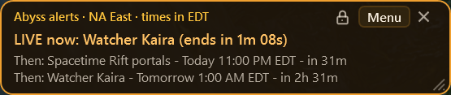</td>
    <td>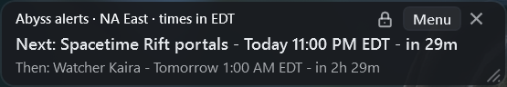</td>
    <td></td>
  </tr>
  <tr>
    <td align="center">Honey</td>
    <td align="center">Midnight</td>
    <td></td>
  </tr>
</table>

### Custom colors
In Settings, **Start from current theme** copies the theme you're using into Custom and opens the **Custom colors** window. **Edit custom colors** opens or closes it. Each color has a **Pick...** button and a **Default** button, and the warning color is one of them.

The color picker has a shade square, a hue slider and a hex box with a copy button. Changes show live in every Wingmate window while you pick; **OK** keeps the color, **Cancel** puts the old one back.

<table>
  <tr>
    <td>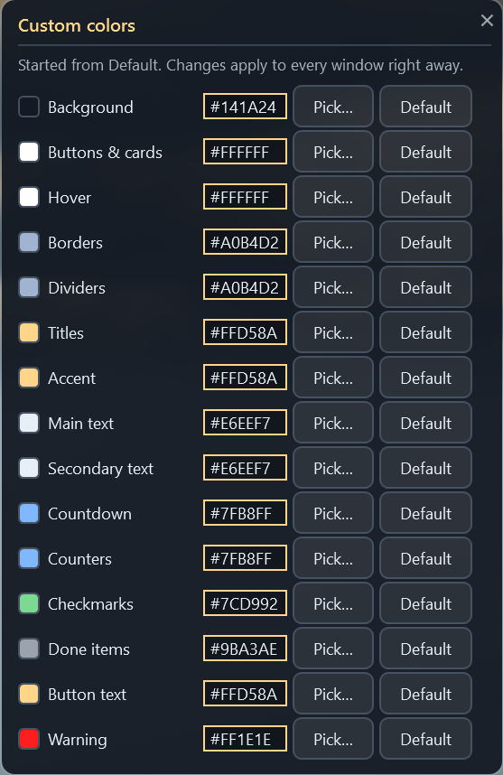</td>
    <td valign="top">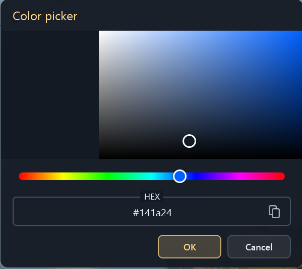</td>
  </tr>
  <tr>
    <td align="center">Custom colors</td>
    <td align="center">Color picker</td>
  </tr>
</table>

### Updates itself
When a new version is out, Wingmate shows a small pop-up: **Update now** downloads it and restarts into the new version, **Later** closes the pop-up. If you pick **Later**, the **Update available** link on the launcher or the tray menu brings the pop-up back. Updating never touches your lists or settings.

Click the version number at the bottom of the launcher or of Settings to open the version history (what changed in each release).

**Wingmate never touches the game.** It doesn't automate anything, read game memory, or hook your keyboard or mouse. It is a separate window that sits on top of the game. The optional window lock hotkey uses the standard Windows hotkey API.

## Install

1. Go to [Releases](https://github.com/BeeSpecial3D/Wingmate/releases/latest) and download **`BeeSpecial3D.Wingmate-win-Setup.exe`**.
2. Run it. Wingmate installs for your user only (no admin needed) and adds Desktop and Start menu shortcuts.

> **"Windows protected your PC"?** Wingmate isn't code-signed yet, so Windows SmartScreen may warn you the first time you run the installer. Click **More info**, then **Run anyway**. You only need to do this once. Wingmate's source code is public, so you can read every line of it in this repo. It doesn't read game memory, inject anything, or automate input.

To uninstall, use Windows **Settings → Apps → Installed apps → Wingmate**.

## Your data

Your settings, characters and checklists live in `%LOCALAPPDATA%\Wingmate`:

| File | What it holds |
|---|---|
| `settings.json` | window positions, theme, alerts, voice |
| `checklist.json` | your characters and their lists |
| `schedule-cache.json` | the latest event schedule |
| `wingmate.log` | a small log, handy for bug reports |

Wingmate saves these files safely: it writes a new copy first and only then swaps it in, keeping the previous version as a `.bak` backup. If a file ever gets damaged, Wingmate falls back to the backup.

The program itself installs to `%LOCALAPPDATA%\BeeSpecial3D.Wingmate`. Updates and uninstalling only touch that folder, so your data is never affected. Back up `%LOCALAPPDATA%\Wingmate` if you'd like a copy.

## Feedback

Found a bug or have an idea? Use **Send feedback** in Settings or the tray menu, or [open an issue](https://github.com/BeeSpecial3D/Wingmate/issues). Including your `wingmate.log` helps.

Wingmate is free. If you'd like to support it: https://ko-fi.com/beespecial3d (or use **Support this app** at the bottom of the launcher; it's no longer in the right-click menus).

## For developers

- Build: `dotnet publish src/Wingmate -c Release -o publish` creates a single self-contained `Wingmate.exe` (win-x64; cross-building from Linux works).
- Tests: `dotnet test tests/Wingmate.Tests`
- Event schedule: [`schedule/schedule.json`](schedule/schedule.json). The app bundles a copy and fetches this file from `main` every 6 hours. Bump `version` when you edit it; the newer version wins.
- Voice clips: `python tools/render_voice.py <kokoro models dir> src/Wingmate/Assets/voice` (Kokoro, voice `af_bella`).
- Release: `vpk pack -u BeeSpecial3D.Wingmate -v <version> -p publish -e Wingmate.exe`, then upload the output to a GitHub release tagged `v<version>`.
