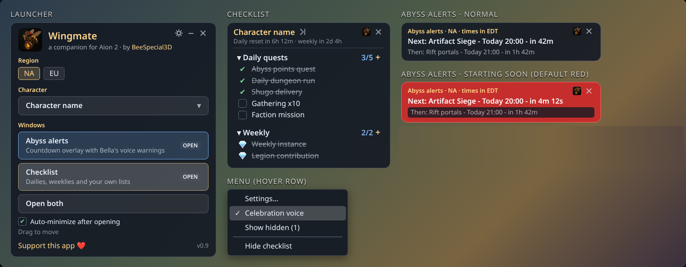

# Wingmate

A free companion app for **Aion 2** by BeeSpecial3D.

- **Abyss and event alerts.** A small countdown overlay for the Abyss and server events (Artifact Siege, Nahma, Rift portals, Arena and more), with spoken warnings from Bella before each one starts. NA and EU times.
- **Checklists for each character.** Daily and weekly lists that reset on their own, plus your own custom lists.
- **Themes.** Current (the default), Elyos, Asmodian, Abyss, Honey, Midnight and Light, each with its own opacity and warning color.
- **Updates itself.** New versions download quietly in the background and install the next time you start Wingmate.

**Wingmate never touches the game.** It doesn't automate anything, read game memory, or hook your keyboard or mouse. It is a separate window that sits on top of the game. The optional click-through hotkey uses the standard Windows hotkey API.

## Install

1. Go to [Releases](https://github.com/BeeSpecial3D/Wingmate/releases/latest) and download **`BeeSpecial3D.Wingmate-win-Setup.exe`**.
2. Run it. Wingmate installs for your user only (no admin needed) and adds Desktop and Start menu shortcuts.
3. Wingmate isn't code-signed yet, so Windows SmartScreen may say *"Windows protected your PC"*. Click **More info**, then **Run anyway**.

To uninstall, use Windows **Settings → Apps → Installed apps → Wingmate**.

## Your data

Your settings, characters and checklists live in `%LOCALAPPDATA%\Wingmate`:

| File | What it holds |
|---|---|
| `settings.json` | window positions, theme, alerts, voice |
| `checklist.json` | your characters and their lists |
| `schedule-cache.json` | the latest event schedule |
| `wingmate.log` | a small log, handy for bug reports |

The program itself installs to `%LOCALAPPDATA%\BeeSpecial3D.Wingmate`. Updates and uninstalling only touch that folder, so your data is never affected. Back up `%LOCALAPPDATA%\Wingmate` if you'd like a copy.

## Feedback

Found a bug or have an idea? Use **Send feedback** in Settings or the tray menu, or [open an issue](https://github.com/BeeSpecial3D/Wingmate/issues). Including your `wingmate.log` helps.

Wingmate is free. If you'd like to support it: https://ko-fi.com/beespecial3d

## For developers

- Build: `dotnet publish src/Wingmate -c Release -o publish` creates a single self-contained `Wingmate.exe` (win-x64; cross-building from Linux works).
- Tests: `dotnet test tests/Wingmate.Tests`
- Event schedule: [`schedule/schedule.json`](schedule/schedule.json). The app bundles a copy and fetches this file from `main` every 6 hours. Bump `version` when you edit it; the newer version wins.
- Voice clips: `python tools/render_voice.py <kokoro models dir> src/Wingmate/Assets/voice` (Kokoro, voice `af_bella`).
- Release: `vpk pack -u BeeSpecial3D.Wingmate -v <version> -p publish -e Wingmate.exe`, then upload the output to a GitHub release tagged `v<version>`.
